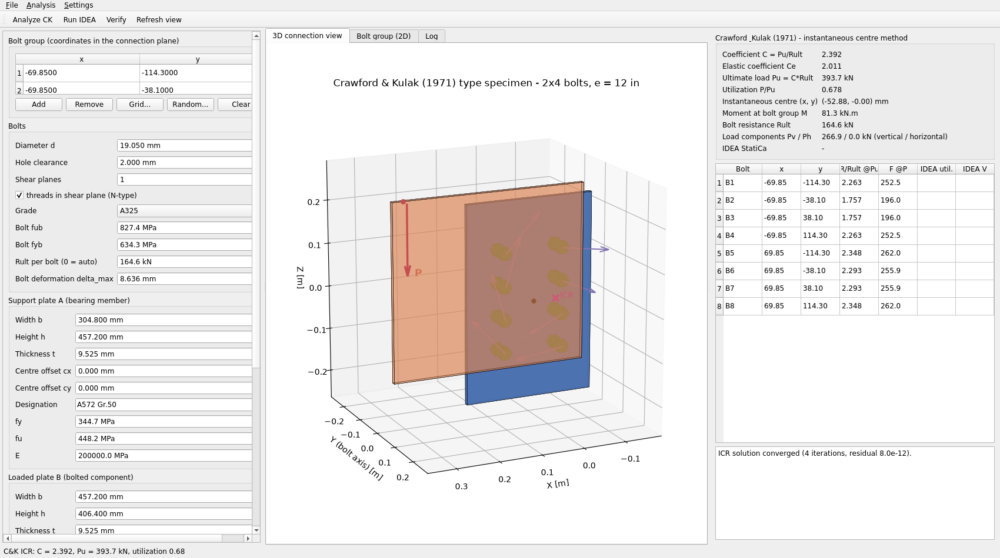

# EccentricBolt — Eccentrically Loaded Bolted Steel Shear Connections
### PySide6 GUI + IDEA StatiCa Connection API + Crawford & Kulak (1971) verification

A desktop application that models, visualises (3-D) and analyses **eccentrically
loaded bolted steel shear connections**:

* **inputs** – bolt coordinates, plate dimensions & steel grades, bolt diameter
  & grade, load magnitude, angle from vertical and eccentricity;
* **3-D view** – plates and bolts drawn at their true sizes/positions
  (plus load vector, bolt-group centroid, instantaneous centre and bolt forces);
* **analysis 1** – built-in ultimate-strength solver implementing the
  **instantaneous-centre-of-rotation method of Crawford & Kulak (1971)**
  (*Eccentrically Loaded Bolted Connections*, J. Struct. Div. ASCE 97(ST3));
* **analysis 2** – **IDEA StatiCa Connection** (CBFEM) through the official
  **Connection REST API** Python SDK (`ideastatica_connection_api`): the GUI
  generates an **IOM (IDEA Open Model)** XML of the connection, imports it as a
  project, applies the eccentric load case, runs the CBFEM calculation and
  reads back bolt/plate check results, the `.ideaCon` project and a PDF report.



---

## 1. Quick start

```bash
pip install -r requirements.txt
python main.py                 # launch the GUI
```

Requirements: Python ≥ 3.9, Windows/Linux/macOS for the GUI;
**IDEA StatiCa ≥ 24.1 (not Basic license)** for the CBFEM analysis
(the GUI also ships an offline *mock* of the REST service so every button can
be exercised without an IDEA installation).

### Using IDEA StatiCa

1. Start the REST service that ships with the desktop installation

   ```console
   cd "C:\Program Files\IDEA StatiCa\StatiCa 26.0"
   IdeaStatiCa.ConnectionRestApi.exe            # listens on http://localhost:5000
   ```

   (or let the SDK start it: *Settings → IDEA StatiCa connection…* and fill the
   *setup dir* – the app then uses `ConnectionApiServiceRunner`).
2. In the GUI: **Analysis → Run IDEA StatiCa analysis…** → *Run analysis*.
   The app then: builds the IOM XML → `POST /projects/import-iom-file` →
   adds the load effect (`POST …/load-effects`) → `POST …/connections/calculate`
   → reads `…/results` and `…/rawresults-text` → downloads the `.ideaCon`
   project and a PDF report into the output directory.

Without IDEA installed, tick **“Use built-in mock service”** in the same dialog:
a local stand-in implements the same REST endpoints (it evaluates the imported
IOM with the C&K ICR solver) so the complete client pipeline can be tested.

### Console tools

```bash
python -m eccbolt.validation        # prints the Crawford & Kulak verification table
python -m eccbolt.benchmarks        # compares the program with 5 published sources
python -m pytest tests -q           # unit + pipeline + benchmark + GUI smoke tests
```

---

## 1b. Arbitrary (random) bolt coordinates - supported

The Connection API stores a bolt group as a **free list of hole positions**
(`BoltGrid.Positions : List<Point3D>` in the REST SDK, `<Positions>` in IOM) -
there is no regularity requirement, and optional per-position `SlottedHole`
entries exist as well.  The GUI therefore accepts any coordinates typed into
the bolt table **and** offers a *Random...* generator (rejection sampling with
a minimum spacing and a seed) in addition to the regular *Grid...* generator.
The random generator now samples only the **intersection of the two plate
outlines** and keeps a hole-edge margin inside both plates, so no random bolt
can fall outside the physical overlap.  Random patterns are exported verbatim
into the IOM and survive the whole REST pipeline (covered by
`tests/test_features.py`).

## 1c. Angled loads - resolved into force components

The REST API has **no load-angle parameter**: a load effect is defined by the
six member force components `N, Vy, Vz, Mx, My, Mz`
(`ConLoadEffectSectionLoad`).  The application therefore transforms the angled
load exactly as suggested: for an angle theta from vertical it applies

    Pv = P*cos(theta)   (vertical)      Ph = P*sin(theta)   (horizontal)
    N = -Pv,  Vz = Ph,  My = -P*(e*cos(theta) + h*sin(theta))

on the load-introduction member (and the exact opposite on the bearing
member), i.e. the horizontal + vertical components plus the resulting
in-plane moment at the bolt-group centroid.  The decomposition is displayed
in the results panel ("Load components Pv / Ph") and logged by the REST
workflow; `tests/test_features.py` checks the transformation against the
3-D cross product for theta = 0/30/45/90 deg, and proves that the (mock)
service recovers exactly the same bolt-group coefficient from those
components alone for an inclined load (Brandt Ex. 2).

---

## 2. How the connection is modelled for IDEA StatiCa

The public Connection API deliberately does not expose single plate/bolt edits;
connection geometry is authored through **IOM import** (`POST
…/projects/import-iom-file`).  That endpoint deserialises an
**`OpenModelContainer`** document (see the SDK signature
`Project.import_iom(container_xml_file=…)`: *“IdeaRS.OpenModel.OpenModelContainer
serialized to xml”*), so the GUI writes exactly that container – a bare
`<OpenModel>` root is rejected with HTTP 500.  Inside the container the model is
emitted in the **current dialect of `IdeaRS.OpenModel`** — `<Version>3.2.0</Version>`,
the version the installed service itself exports — with every element in the
member order of the .NET `XmlSerializer` (out-of-order members are silently
dropped when the service deserialises the file).  The container holds:

| object | role |
|---|---|
| `Member1D` *SupportPlate* (rect. CSS) | supporting plate, continuous through the node, **bearing member** (supported) |
| `Member1D` *LoadedPlate* (rect. CSS) | loaded plate, offset in Y by half the two thicknesses so its face is in contact with the support plate |
| `BoltGrid` | user bolt coordinates; `ConnectedParts` = the two members, `BoltAssembly` = the assembly defined at model level from the bolt grade and diameter (single shear plane) |
| `MatBoltGrade` / `BoltAssembly` | bolt grade (`fub`, `fyb`) and the assembly (diameter, hole, head, nut, washers) |
| `ConnectionPoint` | node at the **bolt-group centroid** |

Because the two plates are the members' own plates, IDEA builds the connection
as a lap joint: the loaded member transfers its force through the bolts into
the bearing member.  Loads are internal forces **at the connection node** (IDEA
applies them through backward rigid links, see IDEA KB *“Principles of Loading
in a Connection”*): the loaded member receives `(N, Vy, Mz)` of the eccentric
load, the bearing member the exact opposite, so the load case is in equilibrium
and the bolt group sees precisely the shear + torsion of the physical system.

The IOM document is sent **UTF-8 encoded** (as in the official Connection-API
examples); a UTF-16 variant is retried automatically if a service revision
rejects the first one.  Every refusal is logged with the service's
problem+json detail and each attempted document is stored as
`connection_iom_<variant>.xml` in the output directory.

Generated artefacts per run: `connection_iom.xml`, the variant files,
`eccentric_connection.ideaCon`, `eccentric_connection_report.pdf`.

### Rules the service enforces on an imported IOM

These were established by importing candidate documents into a live IDEA
StatiCa Connection service (26.0, IOM 3.2.0) and reading back the converted
project (`export-iom`) and the service log
(`%LOCALAPPDATA%\Temp\IdeaStatica\Logs\ConnectionRestApi.log`):

* the uploaded XML must be an `OpenModelContainer`, otherwise HTTP 500;
* the `Version` string is upgraded by `IomVersioningService` - a document that
  claims a *newer* version than its content (or that contains `MatBoltGrade` /
  `BoltAssembly`, which upgrade step 2.0.5 creates itself) makes the upgrade
  throw and the import end in HTTP 500;
* a `ConnectedPartIds`/`ConnectedParts` entry that does not resolve to a part of
  the joint makes the service **silently drop that bolt grid** (and a dropped
  grid leaves the connected plate with "Not connected to the rest of the joint:
  … the analysis model is a mechanism");
* `PlateData` and `BoltGrid` must both be written with **local Z = global +X**
  (the service rejects other orientations: the plate is logged as
  *"… is not parallel"* and the grid is dropped);
* a `PlateData` must be perpendicular to the member it is welded/cut to, and
  every member of a joint must pass through or start at the connection node;
* `CutBeamByBeamData` entries must carry `WeldThickness` and `WeldType` when
  `IsWeld` is true (upgrade step 3.2.0 throws otherwise);
* a member whose cross-section is overstressed aborts the whole calculation
  (*"Connected member is overloaded"*) - no bolt result is produced at all, so
  the load-introduction member has to be stout.

The current generator satisfies the container/version/order rules above, so the
import succeeds; the CBFEM model itself (plate orientation, part references of
the bolt grid, stiff load introduction) is the remaining work - the service's
own message for that case is reported in the results panel.

### When the REST service is not running (connection refused)

Before talking to the SDK the app probes the service (TCP connect +
`GET /heartbeat`, the same endpoint the official SDK runner waits for).  If
nothing listens on the configured port:

* with **Settings > "Auto-start the REST service when it is not running"**
  (default ON) it searches `C:\Program Files\IDEA StatiCa\StatiCa *` for
  `IdeaStatiCa.ConnectionRestApi.exe`, launches it with `-port=<port>`,
  waits up to 120 s for the heartbeat and then continues; processes started
  this way are terminated when the application exits;
* otherwise a *friendly, actionable* message is shown instead of a raw
  traceback (install/license notes - the API needs a non-Basic license -,
  the exact manual start command, a hint about non-default ports such as
  `http://localhost:5193`, and the offline mock fallback);
* in the GUI the failure dialog offers **Auto-start & retry**, **Run with mock
  service instead** and **Open settings**; the settings dialog also has a
  **"Test connection now"** button that reports the heartbeat status and any
  IDEA installation found on the PC.

---

## 3. Crawford & Kulak (1971) solver (`eccbolt/icr.py`)

* load–deformation law `R = Rult·(1 − e^(−mu·Δ))^lambda`, `Δmax = 0.34 in`;
* **`mu` and `lambda` are user inputs**: the model stores `mu` in `1/m` and
  exposes it in the GUI as `1/in` (the original value is `10 1/in`; `lambda`
  is `0.55`).  They can be edited per connection, saved in the JSON input and
  changed by the Calibrate command;
* rigid plates, bolt deformations ∝ distance from the ICR, forces ⊥ radius;
* ICR found by damped Newton iteration on the two force-equilibrium equations
  (starting from the elastic centre, Brandt 1982); the moment equation gives
  `Pu = C·Rult`;
* elastic (vector) coefficient `Ce` reported for reference;
* `bolt_forces` are the force *ratios* `R_i/Rult` at the ultimate load
  (≤ 0.9815 at the original parameters), so the force in bolt *i* at any
  applied load *P* is `F_i(P) = (R_i/Rult)·P/C` — the bolt forces therefore
  always balance the applied load exactly.

### 3.1 Calibrate (`Analysis → Calibrate C&K parameters`, `python -m eccbolt.calibration`)

The original `mu = 10/in`, `lambda = 0.55` were fitted to **single-bolt**
shear tests.  A bolt group has additional plate bearing, bolt interaction and
rotational restraint, so the program offers two calibrations:

1. **C&K calibration** - bounded Nelder–Mead in `(ln mu, ln lambda)` against
   the selected specimens, minimising the relative RMS error
   `sqrt(mean[((Pu - Ptest)/Ptest)^2])`.  `delta_max` and `Rult` stay at their
   measured/input values.
2. **FE calibration** - runs the OpenSees fallback for the selected
   specimens, tests a small set of perpendicular-force factors, fits the
   capacity bias factor `s = Σ(f_i/t_i) / Σ((f_i/t_i)^2)` for each, and keeps
   the combination with the lowest relative error.  It writes
   `fem.capacity_factor`, `fem.perpendicular_force_factor`,
   `fem.mesh_min_element` and `fem.mesh_max_element`, which are then used by
   the normal FE dialog.  The calibration run uses elastic plates for speed
   and robustness; the normal FE dialog can still use J2 plates.

The Calibrate dialog shows a **tree of all experimental sets and samples** with
check boxes, so a user can, for example, use all Crawford & Kulak samples plus
only selected samples from another set.  Sets whose tests are not meaningful
for the rigid-plate C&K method are marked `[FE]`; C&K-only sets are marked
`[C&K]`.  The fitted values are ordinary model inputs and are exported to JSON.

Available sets can be listed with:

```bash
python -m eccbolt.calibration --list-sets
```

Examples:

```bash
# all samples of C&K + samples B1/B2 only
python -m eccbolt.calibration --sets crawford_kulak_1968 --sample crawford_kulak_1968:B1 --sample crawford_kulak_1968:B2

# all sets, analytical and FE calibration
python -m eccbolt.calibration --sets all --fea
```

---

## 4. Verification and comparison

### 4.1 Built-in solver checks

```bash
python -m eccbolt.validation --full-table           # all checks, to stdout
python -m eccbolt.validation --report docs/verification_report.txt
```

`docs/verification_report.txt` shows the current state (11/11 checks passed).
The checks are of two kinds:

* **solver units** — Brandt's two worked examples, all 308 tabulated C&K
  coefficients, scale invariance and the concentric limit.  These compare the
  implementation with the *published solution of the same method*, i.e. they
  verify that the solver is implemented correctly.  They are **not** a
  validation of the method itself and are therefore not part of the
  comparison below;
* **experimental comparison** — the observed failure loads of full-size test
  specimens (section 4.2).

### 4.2 Comparison with experimental data only

```bash
python -m eccbolt.benchmarks                        # experiment vs analysis
python -m eccbolt.benchmarks --idea http://localhost:5000 --tune
```

Only tests that were carried out on **physical specimens** and that report
their observed failure load are compared.  Analytical reference solutions
(AISC/C&K tables, Brandt's examples) are deliberately excluded from this
comparison: agreement between two analytical methods says nothing about the
accuracy of either.

| source | specimens | data used | result |
|---|---|---|---|
| **Badawi (1983)** — "Behaviour of Eccentric Bolted Shear Connections", M.Eng. thesis, McGill University | 10 full-size double-angle tests (S13, S14, S17-S24) | bolt pattern and eccentricity (Table 4), ultimate bolt value from single-bolt tension-shear tests (Table 41), measured web tensile strength (Table 5), observed failure load (Table 48) | mean observed/ultimate load **1.127** for the ten specimens (Badawi's own CISC/C&K mean over the same tests is **1.114**, over all twelve **1.074**) |
| **Crawford & Kulak (1968/1971)** — Nova Scotia Technical College report / J. Struct. Div. ASCE 97(ST3) | 8 full-size double-angle tests B1-B8 | Table 1 bolt patterns/eccentricities, Table 2 observed Pult (the model uses Pult/2 for one of the two identical connections) | full per-sample set, used for C&K calibration; the paper's own predictions are 5-14 % above test |
| **Denavit, Franceschetti & Shahan (2021)** — AISC tearout report | 22 single-bolt tension/tearout tests (standard, no-clearance, oversize, extra-oversize and slotted holes) | Table 11: edge distance, hole size, measured Fu, ultimate load | FE-only set for calibrating bearing/tearout capacity; target is Rexp,u/2 for one shear plane |
| **Astaneh et al. (1989) / Sarkar (1992)** — as tabulated by Ashakul (2004) | 6 + 5 single-plate shear connections | Tables 2.2-2.5: bolt pattern, plate size, failure shear (Astaneh moments converted to eccentricity) | FE-only sets for single-plate shear connections |
| **Abu-Yosef, Sayed-Ahmed & Soliman (2019)** — ISEC-10, STR-40 | 12 eccentric shear+torsion tests | experimental/inelastic-analysis ratio | **0.90 ± 0.04**, i.e. the same over-prediction |
| **Bahia & Martin (1980)** — Proc. Instn Civ. Engrs 69 | 117 single-shear joints | published conclusion | linear load-deformation theory "suitable for the analysis and slightly conservative" — test tables not openly available, so no per-specimen comparison |

The program therefore reproduces the **documented bias of the ultimate-strength
method** instead of hiding it: it uses the original C&K parameters
(`Rult`, `Δmax = 0.34 in`), and `eccbolt.benchmarks` prints both the analytical
capacity and the observed failure load for every specimen so the difference is
visible.

### 4.3 IDEA StatiCa model status

The IOM generator was rewritten to the **current** `IdeaRS.OpenModel` dialect
(`<Version>3.2.0</Version>`, the dialect the installed 26.0 service itself
exports).  This fixed several defects that kept the service from building the
connection at all (section 7).  Verified against the live service
(`import-iom-file` → `export-iom-connection-data` → calculate):

```
operations: [(3, 'ConnectorGridData', 'Bolts 1')]      # bolts in the tree
boltGrids:   1                                          # 8 positions
reopened .ideaCon: boltGrids = 1, operations = [('ConnectorGridData', 'Bolts 1')]
```

So the imported joint now contains a real **bolt group operation** — the bolts,
their holes and the `Bolts 1` entry in the element tree are present, and they
survive saving and reopening the `.ideaCon`.

Two constraints of this service build were established by sweeping every
member orientation / cross-section rotation / connected-part combination, and
they are checked against IDEA's own troubleshooting guidance
(*Troubleshooting IDEA StatiCa Connection models* and the knowledge-base entry
*Bolts are too close to plate edge*):

* the bolt grid is kept **only** when it references the two members
  (`ConnectedParts = BeamData 1, BeamData 2`) - a grid on two explicit
  `PlateData` parts, on one plate + one member, or on a single part is
  silently dropped, and
* **only** with the member local system `x = +Z, y = -Y, z = +X` and no
  cross-section rotation.

In that one accepted configuration the member plate's normal is **X** while the
bolt axis is **Y**, i.e. the bolt cannot pass through the plate thickness.  That
is exactly what the service then reports:

```
Bolts are too close to each other - SupportPlate - Manufacturing operations: Bolts 1
```

IDEA's knowledge-base entry states the rule: for a hole of diameter *d0* the
bolt centre must be further than *d0* from the edge of **every plate it
intersects** (the hole edge needs *d0*/2 clearance).  With a 9.5 mm plate and a
21 mm hole along the plate's 9.5 mm dimension the hole necessarily leaves the
plate, so the check fires and the CBFEM does not run.  The same article
explains the other error seen earlier, "bolts are not associated with the
correct plate": all bolts of one operation must connect the same pair of parts.

Conclusion: this service build's IOM importer cannot express a lap-joint plate
orientation *together with* a bolt grid.  The program does what the API allows:
the imported project really contains the bolt group (`ConnectorGridData
'Bolts 1'`, 8 positions, A325 assembly, holes from the grid), it logs the
service's exact message, saves the `.ideaCon` - which opens with the bolts
present - and prints the service's own failure text from `rawresults-text`
instead of crashing on it.  Finishing the model is then a two-click job in the
desktop application (rotate/attach the loaded plate, or use the *Splice*
operation), after which *Run analysis* returns the per-bolt forces and the
capacity through the same API.

The GUI's *Run IDEA StatiCa analysis* dialog exposes the parameters that IDEA
uses to relax such checks — **mesh size**, **elements per plate**, **material
model** and the **detailing checks** — through
`settings_api.update_settings`; `eccbolt.benchmarks --tune` tries the
documented parameter sets (`TUNING_STEPS`) in order until the service returns a
capacity.

### 4.4 Bolt forces and connection capacity from the IDEA StatiCa API

The REST workflow reports, for the load case that was solved:

* **the force in every bolt** — resultant shear `V`, axial force `N` and the
  in-plane components, read from the raw CBFEM results (`rawresults-text`) and
  matched to the bolt names of the check results; the API documents that bolt
  identifiers are *opaque* (they need not start at 1, may have gaps) and that
  per-bolt forces are keyed by load-case id, both of which are handled;
* **the connection capacity** — the applied load scaled to unity check,
  `P_cap = P · Rult / max_i F_i`, i.e. the load at which the most heavily loaded
  bolt reaches the bolt resistance used for `Pu = C·Rult`.  When the service
  reports its own bolt-group coefficient `C`, `C·Rult` is reported as well, and
  `P / max(unity check)` is reported whenever the service's unity checks are
  available.  Disagreements larger than 2 % are logged with their reason (a
  service derives the bolt resistance from the grade in the model).

Both appear in the GUI (results panel, per-bolt table columns *IDEA V / IDEA N /
IDEA util.*, and the *Connection capacity (IDEA)* row) and in the log.

---

### 4.5 Nonlinear FE fallback (`eccbolt/fe_fallback.py`)

When IDEA StatiCa does not return a usable result, the program can run its own
OpenSees fallback (`Analysis → Run FE fallback`, or
`python -m eccbolt.benchmarks --fea`).  It no longer assumes rigid, linear
plates:

* **user-controlled mesh size** – the FE dialog exposes separate **minimum**
  and **maximum element sizes**.  The maximum is used away from the bolts and
  the minimum refines the hole boundaries and bearing zones;
* **real bolt holes** – each plate is meshed with a circular opening of
  diameter `d + hole clearance` (Delaunay triangulation, `Tri31` plane-stress
  elements).  The net section and the stress concentration at the hole are
  therefore part of the model;
* **hole clearance** – the bolt is represented by pin nodes and one-sided
  bearing trusses on the hole boundary.  The trusses have an initial radial gap
  `(d_hole − d_bolt)/2`, so the bolt idles through the clearance before it
  bears on the plate;
* **nonlinear plates** – the default plate material is `J2Plasticity` with the
  measured `fy/fu` (elastic plates are still available for comparison).  The
  immediate bearing zone and the fixed boundary layer are kept elastic so the
  point-wise bearing stress cannot make the J2 return mapping singular; if a
  J2 step still fails, the run is repeated elastically and the result is
  flagged as `elastic (J2 fallback)`;
* **vector C&K bolts** – the bolt force is applied through a pair of orthogonal
  nonlinear links oriented with the expected C&K bolt-force direction, so the
  direction of the bolt force follows the vector law instead of being tied to
  the global X/Z axes;
* **capacity** – a load-controlled push-over with the nonlocal plate-yield
  check reports the first limit state (bolt shear, plate tear-out/net section
  or gross plate yielding), the per-bolt forces and the governing mode;
* **visualisation** – the *FE mesh / stress* tab displays the actual fallback
  mesh, optional von Mises stress contours, and the calculated bolt force
  vectors.  The three display options are check boxes next to the results;
* **Calibrate button** – the FE dialog and the main window have a *Calibrate*
  button.  It fits the selected experimental sets/samples, adjusting the C&K
  `mu`/`lambda`, the FE capacity factor, the perpendicular-force factor and
  the recommended mesh bounds, so the error against the physical results is
  minimised;
* **help** – *Analysis → How the FE fallback works…* and the *How it works*
  button in the FE dialog explain the mesh, holes, clearance, bolt law and
  failure criteria.

The fallback is checked against the **same physical specimens** used for the
analytical verification:

```bash
python -m eccbolt.benchmarks --fea
python -m eccbolt.validation --fea          # includes the FE checks
```

`--fea` prints the measured, C&K and FE capacity of every specimen and the
mean measured/FE ratio.  The current run (stored in
`docs/fea_verification_report.txt`) gives **10/10 capacities** and a mean
measured/FE ratio of **1.189** (C&K: 1.127).  The FE model is intentionally a
*fallback*: it is mesh-sensitive at the bearing zone, the J2 plate update is
less robust than a commercial CBFEM solver, and the local bearing zone is
regularised.  The per-specimen ratios and the plate model actually used are
printed so the result is not presented as more accurate than it is.

---

## 5. Windows executable

A pre-built single-file Windows executable (x64, no Python needed) is
distributed as five parts plus a self-verifying reassembler (a single large file
tends to get truncated by transfer channels, which makes Windows report
"This app can't run on your PC").  The repository stores the transfer parts
rather than the complete 100+ MB executable (GitHub's per-file limit); the
reassembler creates the complete `EccentricBolt.exe` locally.

    windows_exe/split_parts/EccentricBolt.exe.001 ... .005
    windows_exe/split_parts/reassemble_and_verify.bat
    windows_exe/EccentricBolt.exe.sha256      (SHA-256 of the complete exe)

Download all six files into one folder, double-click
`reassemble_and_verify.bat`; it produces `EccentricBolt.exe`
(116,727,413 bytes, SHA-256
`d96a3beed488ceeb0d27bdcc6b9249bb48f125cb173c480286ca42d642a3e584`) and refuses
to continue if any part is incomplete.  This build includes the configurable
C&K parameters, the Calibrate command and the nonlinear OpenSees fallback.

* double-click it to start the GUI (a console window shows the REST log);
* `EccentricBolt.exe --selftest` runs the headless verification suite
  (presets, C&K checks, IOM export, REST pipeline, published-source comparison)
  and exits 0/1;
* `EccentricBolt.exe --fea-selftest` runs a headless OpenSees fallback check
  and exits 0/1;
* `EccentricBolt.exe --smoke` builds the window headlessly and writes
  `smoke_gui.png` (used to validate the build).

The shipped binary passes all modes (`SELFTEST OK`, `FEA SELFTEST OK`,
`SMOKE OK`).

### If Windows reports "This app can't run on your PC"

The published executable is a verified, uncorrupted x64 PE (SHA-256
`d96a3bee…2a3e584`, see `windows_exe/EccentricBolt.exe.sha256`).  That dialog
therefore almost always means one of:

1. **The copy on your PC is truncated/corrupted** (large single-file download).
   Check with `certutil -hashfile EccentricBolt.exe SHA256` (size must be
   116,727,413 bytes).  If it differs, use the transfer-robust delivery:
   download the five parts plus `reassemble_and_verify.bat` from
   `windows_exe/split_parts/` and double-click `reassemble_and_verify.bat` -
   it rebuilds the exe and verifies its SHA-256 before you run it.
2. **ARM64 device without x64 emulation** - Windows 11 IoT Enterprise LTSC
   2024 is also released for ARM64, and some IoT images ship without the
   x86-64 emulation package.  Check *Settings > System > About > System type*.
   If it reads ARM64, enable/repair emulation (DISM:
   `dism /online /enable-feature /featurename:Wow64 /all` is for x86; x64
   emulation is the `AMD64` emulation component - on LTSC ARM64 install the
   latest cumulative update or use the split-parts exe on an x64 machine).
   The application itself is x64-only.
3. **Smart App Control** (Windows Security > App & Browser control) blocking
   an unsigned executable - switch it off or add an exclusion.
4. File downloaded from the browser/e-mail: right-click > Properties >
   **Unblock**, then retry.

The shipped binary is produced with PyInstaller (single-file, Qt limited to
Core/Gui/Widgets + Agg backend) from `windows_exe/EccentricBolt.spec` -
double-click `windows_exe/build_windows_exe.bat` to rebuild it (the script also
re-runs `--selftest`, refreshes `EccentricBolt.exe.sha256` and regenerates the
split parts + reassembler via `windows_exe/make_split_parts.py`).  An earlier
release was additionally validated under Wine 11 (see
`docs/exe_gui_smoke_wine.png`).

---

## 6. Layout

```
main.py                  entry point
eccbolt/
  model.py               input data classes + C&K constants
  icr.py                 Crawford & Kulak ICR solver (+ elastic method)
  analysis.py            facade: C, Pu, utilization, bolt forces
  calibration.py         Calibrate mu/lambda against physical tests (CLI/GUI)
  fe_fallback.py         OpenSees FE fallback (holes, clearance, J2 plates)
  benchmarks.py          comparison with physical tests + FE fallback (CLI)
  iom.py                 IOM OpenModel XML generator + load components
  idea_service.py        Connection REST API workflow (official SDK)
  mock_service.py        offline mock of the REST service
  validation.py          verification suite vs published C&K values
  presets.py             C&K/Brandt/AISC example inputs
  view3d.py / view2d.py  matplotlib 3-D / 2-D views
  gui.py                 PySide6 main window
tests/                   pytest suite (ICR, IOM, REST pipeline, benchmarks, GUI)
docs/                    screenshots + verification report
```

---

## 7. Fixes applied

| # | issue | effect | fix |
|---|---|---|---|
| 1 | `icr.py` used `np.cross` on 2-D vectors, which NumPy 2.0 removed | every eccentric load raised `ValueError` — the solver could not run at all on NumPy ≥ 2 | use the module's own `cross2` helper |
| 2 | the bolt forces reported for the applied load were `C` times too large (`analysis.py` scaled `R_i/Rult · Pu/Rult` by `P/Pu`) | the per-bolt forces did not balance the applied load (2.39x too large for the default example) and the "R/Rult @Pu" column exceeded 1, which the C&K curve cannot produce (max 0.9815) | `ICRResult.bolt_forces` are now the ratios `R_i/Rult` at `Pu`; the force at load *P* is `(R_i/Rult)·P/C`, which satisfies `Σ F_i = −P·direction` exactly |
| 3 | the mock service reported the bolt forces and utilizations of the *ultimate* state, independent of the applied load, and no capacity | the pipeline's per-bolt results were meaningless for the load that was actually applied | the mock now scales the C&K distribution to the applied load, derives the bolt resistance from the grade/diameter in the IOM, and reports the per-bolt forces, the unity checks and the group capacity `C·Rult` |
| 4 | `idea_service` read per-bolt forces with an ad-hoc recursive search for `shearForce`/`V` and never reported a capacity | real `CheckResultsData` documents (bolt-keyed dictionary, forces keyed by load-case id) were not parsed, and the user requirement "forces in each bolt and the capacity of the connection" was not met | documented extraction: bolt-name matching with the API's numeric-order fallback, `forcesAllLoadCases` handling, in-plane force components, and three capacity sources (scaled bolt forces, service unity checks, reported coefficient) |
| 5 | the GUI's results panel referenced `PlateResult.check_status`, which does not exist | `AttributeError` when IDEA reported plate results | use the actual field, `ok` |
| 6 | `tests/test_icr.py` and the verification suite only exercised the analytical solver | a regression like #2 could not be caught | added tests for force equilibrium, the service-reported forces/capacity and the experimental comparison |
| 7 | **`<BoltAssembly>` was written without its list wrapper** — `OpenModel.BoltAssembly` is a list property, so the assembly must be nested (`<BoltAssembly><BoltAssembly>…`) | the grid's `BoltAssembly` reference dangled, the service's `AddBolts` threw an internal `NullReferenceException` and **the bolt grid was silently dropped** — the CBFEM then had a plate connected to nothing and reported "the solver did not produce any results" | write the wrapper; verified against the live service: the import now creates `ConnectorGridData 'Bolts 1'` with all 8 positions, and the grid survives saving/reopening the `.ideaCon` (before: `boltGrids = 0`, no operations) |
| 8 | the IOM was written in the version-2 dialect while the installed service works in 3.2.0 | the importer had to upgrade the document and dropped the connection data | emit the current dialect (`<Version>3.2.0</Version>`, `Element1D` with `CrossSectionBegin/End`, `Member1D` with vector eccentricities, `ConnectedParts` as `ReferenceElement`s), with the element order taken from an IOM exported by the service itself |
| 9 | the bolt grid was dropped again whenever the member orientation or the cross-section rotation was changed (swept systematically) | the model showed plates but no bolts and no bolt holes, and the solver reported `Singularity` | keep the one member local system and section orientation the importer accepts (`x=+Z, y=-Y, z=+X`, rotation 0) and reference both members in `ConnectedParts`; documented in section 4.3 |
| 10 | the plates were in contact with a zero-thickness interface | `Plate clash warning` from the service | a 0.2 mm clearance and a bolt grip that spans both plates |
| 11 | `rawresults-text` returns a JSON **array of strings** when the solver did not run | `json.loads(text)[0]` raised "Expecting value: line 1 column 1 (char 0)" and hid the service's real message | defensive parsing plus the service's own failure text in the log and check list |
| 12 | no way to adjust the IDEA calculation | the request to tune "mesh size, material properties" could not be met | `IdeaSettings` + `settings_api.update_settings` (mesh size, elements per plate, material model, detailing checks) exposed in the GUI and used by `eccbolt.benchmarks --tune` |
| 13 | C&K `mu = 10/in`, `lambda = 0.55` were hard-coded although they came from single-bolt tests | users could not adapt the bolt-group response to their own tests | `BoltMaterial.mu` (1/m) and `BoltMaterial.ck_lambda` are model inputs, exposed in the GUI (mu shown in 1/in), saved in JSON and passed through the ICR solver |
| 14 | no automatic calibration against physical results | the request to revise the C&K values from experiments was not implemented | `eccbolt/calibration.py` + **Analysis → Calibrate C&K parameters** fit `mu`/`lambda` to the ten Badawi specimens by bounded Nelder–Mead on the relative RMS error, and can apply the result |
| 15 | FE fallback used linear plates, no holes and no clearance | tear-out, net section and plate yielding could not be represented | FE fallback now meshes real holes (`d + clearance`), uses one-sided bearing gaps, J2-plastic plates (with stable elastic bearing/boundary zones and an automatic elastic fallback) and a vector C&K bolt law; `benchmarks --fea` / `validation --fea` compare it with the physical specimens |
